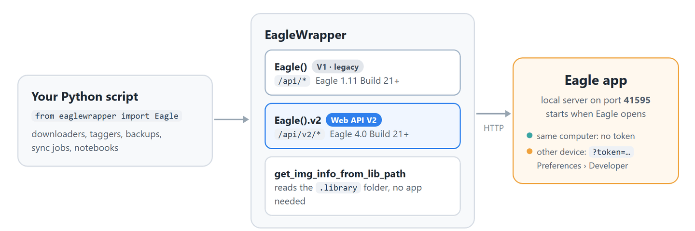

<div align="center">


**Script [Eagle](https://eagle.cool/) from Python: both of its local HTTP APIs, V1 and the new Web API V2.**

[](https://pypi.org/project/EagleWrapper/)
[](https://pypi.org/project/EagleWrapper/)
[](https://github.com/NatLee/eagle-wrapper/actions/workflows/test.yml)
[](https://github.com/NatLee/eagle-wrapper/actions/workflows/release.yml)
[](https://pypi.org/project/EagleWrapper/)
[](https://github.com/NatLee/eagle-wrapper/blob/main/LICENSE)

</div>

Eagle is a desktop app for collecting and organizing images, videos, fonts and other design references.
While it is open, it runs a small HTTP server on your computer (port `41595`), and anything that can send
HTTP requests can add files to it, search it, tag things and manage folders. EagleWrapper turns that server
into plain Python methods, so a downloader, a tagging script or a backup job is a few lines of code.
It can also read an Eagle library folder straight from disk when the app is closed.



## Which Eagle API? (checked November 2026)

Eagle has not switched its API off. It now has two, on the same port:

| | V1 (legacy) | Web API V2 |
|---|---|---|
| Paths | `/api/...` | `/api/v2/...` |
| Needs | Eagle 1.11 Build 21 or later | Eagle 4.0 Build 21 or later (smart folders and comments: Build 22) |
| Status | Still documented; Eagle calls it legacy and has announced no end date | Current, much larger |
| Docs | [api.eagle.cool](https://api.eagle.cool/) | [developer.eagle.cool/web-api](https://developer.eagle.cool/web-api) |
| In this package | the methods of `Eagle()` | `Eagle().v2` |

Calls from the same computer need no token. Calls from another device on your network need the API token from
Eagle > Preferences > Developer, sent as `?token=...` on every request ([V2 docs: Authentication](https://developer.eagle.cool/web-api/get-started/readme#authentication)).

## Install

```bash
pip install EagleWrapper
```

Python 3.6 or later. Eagle must be running for everything except the library-folder reader.
Web API V2, the connection options and the new exceptions arrived in 1.2.0.
Which release speaks which Eagle API, and what to pin: see [Versioning](#versioning).

## Quick start

```python
from eaglewrapper import Eagle

eagle = Eagle()  # http://localhost:41595

# V1: add an image from a URL. Positional arguments: url, name, tags, website, annotation.
eagle.add_from_url(
    'https://example.com/bocchi.jpg', 'ぼっち・ざ・ろっく！', ['ぼっち', 'ろっく'],
    'https://example.com/news/bocchi', 'This is an example ;)')

# V2 (Eagle 4.0 Build 21+): full-text search, then walk through every page of a filter.
if eagle.supports_v2():
    print(eagle.v2.app.info()['version'])
    print(eagle.v2.item.query('ぼっち OR cat')['total'], 'matches')
    for item in eagle.v2.item.iterate(tags=['ろっく'], fields=['id', 'name']):
        print(item['id'], item['name'])
```

This is what the `add_from_url` call looks like in Eagle:


## Connecting

Everything is optional; with no arguments `Eagle()` talks to `http://localhost:41595` like it always did.

```python
import requests
from eaglewrapper import Eagle

eagle = Eagle(
    base_url='http://192.168.1.20:41595',  # Eagle on another computer (default: domain + port)
    token='f366c476-7533-4f33-b454-2bc720a1d0ea',  # or set EAGLE_API_TOKEN instead of writing it here
    timeout=30,                 # seconds; the default waits as long as Eagle needs
    session=requests.Session(), # reuse connections across many calls
    raise_errors=True,          # V1 methods raise EagleAPIError instead of returning False/None
)
print(eagle.host, eagle.list_folders() is not None)
```

`Eagle('http://localhost', 41595)` (the 1.1.1 way) still works. `eagle.v2` uses the same settings.
You can also use V2 on its own with `EagleV2(base_url, token=...)`.

## When something goes wrong

| What happened | What you get | Also catchable as |
|---|---|---|
| Eagle is closed, or the host or port is wrong | `EagleConnectionError` with a hint | `requests.ConnectionError` (what 1.1.1 raised) |
| The reply is not JSON, e.g. a V2 call on an Eagle older than 4.0 Build 21 | `EagleResponseError` | `ValueError` (what 1.1.1 raised) |
| Eagle answered `{"status": "error"}` to a **V2** call | `EagleAPIError` (`.message`, `.endpoint`, `.status_code`, `.payload`) | `EagleError` |
| Eagle answered `{"status": "error"}` to a **V1** call | `False` or `None` as in 1.1.1, plus a logged warning; with `raise_errors=True`, `EagleAPIError` | |

All of them are subclasses of `EagleError`. `update_item` has always raised on failure and still does.

```python
from eaglewrapper import Eagle, EagleAPIError, EagleConnectionError

try:
    Eagle().v2.tag.merge('photograph', 'photography')
except EagleConnectionError:
    print('Is Eagle open?')
except EagleAPIError as e:
    print('Eagle said no:', e.message)
```

## Web API V2 reference

`eagle.v2` is grouped like the [official docs](https://developer.eagle.cool/web-api): `POST /api/v2/tag/merge`
is `eagle.v2.tag.merge(...)`. Methods return the `data` part of Eagle's reply. Filters and options are
keyword arguments in snake_case (`is_untagged=True` is sent as `isUntagged`); arguments you leave out are not sent.

List endpoints are paginated: you get `{'data': [...], 'total': 1250, 'offset': 0, 'limit': 50}`. Eagle returns
50 rows unless you pass `limit` (maximum 1000). The `iterate...` helpers fetch page after page for you.

| Area | Method | Endpoint |
|---|---|---|
| **Item** | `item.get(tags=, folders=, keywords=, ext=, rating=, shape=, is_untagged=, fields=, offset=, limit=, ...)` | `POST item/get` |
| | `item.iterate(page_size=200, **filters)` · `item.get_by_id(item_id)` | `item/get` |
| | `item.query('(cat OR dog) -cartoon', limit=)` · `item.iterate_query(query)` | `POST item/query` |
| | `item.count_all()` | `GET item/countAll` |
| | `item.add(url= \| path= \| base64= \| bookmark_url=, name=, tags=, folders=, annotation=, website=)` → new ID | `POST item/add` |
| | `item.add_many([{'url': ...}, {'path': ...}])` → new IDs (up to 1000) | `POST item/add` |
| | `item.update(item_id, name=, tags=, folders=, annotation=, url=, star=, is_deleted=, ...)` | `POST item/update` |
| | `item.set_custom_thumbnail(item_id, file_path)` · `item.refresh_thumbnail(item_id)` | `POST item/...` |
| | `item.get_comments` · `add_comment` · `update_comment` · `remove_comment` (Build 22) | `item/...Comment(s)` |
| **Folder** | `folder.get(folder_id=, folder_ids=, is_selected=, is_recent=)` · `folder.iterate()` | `POST folder/get` |
| | `folder.create(name, description=, parent=)` | `POST folder/create` |
| | `folder.update(folder_id, name=, description=, tags=, icon_color=, parent=, move_to_root=)` | `POST folder/update` |
| **Smart folder** (Build 22) | `smart_folder.get` · `create(name, conditions)` · `update` · `remove` · `get_items(id)` · `get_rules()` | `smartFolder/...` |
| **Tag** | `tag.get(name=)` · `tag.iterate()` · `tag.get_recent()` · `tag.get_starred()` | `tag/get...` |
| | `tag.rename(original_name, new_name)` · `tag.merge(source, target)` | `POST tag/update`, `tag/merge` |
| **Tag group** | `tag_group.get` · `create(name, tags)` · `update(id, name, tags)` · `remove` · `add_tags` · `remove_tags` | `tagGroup/...` |
| **Library** | `library.info()` · `library.history()` · `library.switch(path)` · `library.icon(path)` → bytes | `library/...` |
| **App** | `app.info()` | `GET app/info` |
| **AI search** | `ai_search.is_installed()` · `is_ready()` · `get_sync_status()` · ... | `GET aiSearch/...` |
| | `ai_search.search_by_text('an orange cat', limit=)` · `search_by_base64` · `search_by_item_id` | `POST aiSearch/searchBy...` |
| **Anything else** | `v2.request('GET', 'item/countAll')` for endpoints added after this release | any |

```python
from eaglewrapper import Eagle

v2 = Eagle().v2
new_id = v2.item.add(url='https://example.com/cat.jpg', name='Cat', tags=['cat'])
v2.item.update(new_id, star=5, annotation='Good cat')
folder = v2.folder.create('Cats')
v2.item.update(new_id, folders=[folder['id']])
for tag in v2.tag.iterate(name='ca'):
    print(tag['name'], tag['count'])
if v2.ai_search.is_ready():
    for hit in v2.ai_search.search_by_text('an orange cat', limit=5)['results']:
        print(round(hit['score'], 2), hit['item']['name'])
```

AI search needs Eagle's [AI Search plugin](https://eagle.cool/support/article/ai-search). Smart folders and comments
need Eagle 4.0 Build 22. On an older Eagle those calls fail with `EagleResponseError` or `EagleAPIError`.

## V1 (legacy) reference

These are the methods of 1.1.1, unchanged, plus `star`, `get_library_icon` and `supports_v2`. Every endpoint has its own page in the [V1 docs](https://api.eagle.cool/).

| Area | Method | Endpoint | Returns |
|---|---|---|---|
| **Application** | `get_application_info()` | `GET /api/application/info` | dict |
| **Item** | `add_from_url(url, name, tags, website, annotation, modification_time, folder_id, headers, star)` | `POST /api/item/addFromURL` | bool |
| | `add_from_urls(items, folder_id)` | `POST /api/item/addFromURLs` | bool |
| | `add_from_path(path, name, website, annotation, tags, folder_id)` | `POST /api/item/addFromPath` | Eagle's reply (dict) |
| | `add_from_paths(items, folder_id)` | `POST /api/item/addFromPaths` | bool |
| | `add_bookmark(url, name, tags, thumbnail_base64, modification_time, folder_id)` | `POST /api/item/addBookmark` | bool |
| | `get_item_info(item_id)` | `GET /api/item/info` | dict or None |
| | `get_thumbnail_path(item_id)` | `GET /api/item/thumbnail` | str or None |
| | `list_items(limit=200, offset, order_by, keyword, ext, tags, folders)` | `GET /api/item/list` | list |
| | `get_img_list_info(max_image_number, name_start_filter)` | `GET /api/item/list` | list, filtered by name |
| | `move_to_trash(item_ids)` | `POST /api/item/moveToTrash` | bool |
| | `refresh_palette(item_id)` · `refresh_thumbnail(item_id)` | `POST /api/item/refresh...` | bool |
| | `update_item(item_id, tags, annotation, url, star)` · `set_tag_with_id(item_id, tags)` | `POST /api/item/update` | dict, raises on failure |
| **Folder** | `create_folder(folder_name, parent_id)` | `POST /api/folder/create` | dict |
| | `rename_folder(folder_id, new_name)` | `POST /api/folder/rename` | dict |
| | `update_folder(folder_id, new_name, new_description, new_color)` | `POST /api/folder/update` | dict |
| | `list_folders()` · `get_recent_folders()` | `GET /api/folder/list`, `listRecent` | list |
| **Library** | `get_library_info()` | `GET /api/library/info` | dict |
| | `get_library_history()` | `GET /api/library/history` | list of paths |
| | `switch_library(library_path)` | `POST /api/library/switch` | bool |
| | `get_library_icon(library_path)` | `GET /api/library/icon` | bytes or None |
| **No API** | `get_img_info_from_lib_path(library_path, name_start_filters, max_workers, match)` | reads the library folder | list |
| **Helpers** | `supports_v2()` · `check_success(response_or_dict)` | | bool |

`add_from_path` returns Eagle's whole reply (a dict such as `{'status': 'success'}`), not a bool, because
1.1.1 did and scripts may read it. A dict is always truthy, so `if eagle.add_from_path(...)` passes even when Eagle
refused the file. Check the reply, or let failures raise:

```python
from eaglewrapper import Eagle, EagleAPIError

eagle = Eagle()
reply = eagle.add_from_path('/path/to/cat.jpg', 'Cat')
if eagle.check_success(reply):  # True only for {'status': 'success', ...}
    print('added')
else:
    print('Eagle said no:', reply)

try:
    Eagle(raise_errors=True).add_from_path('/path/to/cat.jpg', 'Cat')
except EagleAPIError as e:
    print('Eagle said no:', e.message)
```

## Reading a library folder without Eagle

An Eagle library is a folder (`My.library`) with one `images/<id>.info/metadata.json` per item.
`get_img_info_from_lib_path` reads those files directly, which is faster than the API for big libraries and
works while Eagle is closed. The library's own settings file is skipped.

```python
from eaglewrapper import Eagle

eagle = Eagle()
library = '/path/to/Design.library'

everything = eagle.get_img_info_from_lib_path(library)
# Names starting with "example" OR "ぼ":
some = eagle.get_img_info_from_lib_path(library, ['example', 'ぼ'], match='any')
# Default (as in 1.1.1): a name must start with EVERY prefix.
both = eagle.get_img_info_from_lib_path(library, ['ex', 'example'])
print(len(everything), [i['name'] for i in some], [i['name'] for i in both])
```

## Upgrading from 1.1.1

Nothing to change: every 1.1.1 method keeps its name, its parameters and their order, and sends the same
requests (a test pins the signatures, and the requests were compared against a fake Eagle). What you may notice:

- When Eagle reports a failure, the V1 methods still return `False` or `None`, and now also log a warning.
- A closed Eagle raises `EagleConnectionError` and a non-JSON reply `EagleResponseError`. They are subclasses of
  the exceptions 1.1.1 let through, so existing `except` clauses still catch them.
- `get_img_list_info` returns `None` when Eagle fails, where 1.1.1 crashed with a `TypeError` if a filter was given.
- `get_img_info_from_lib_path` treats a single string filter as one prefix (1.1.1 used every character as a
  prefix), skips items without a name when filtering, and returns files in a stable order.

Moving a V1 script to V2 when your Eagle is 4.0 Build 21 or later:

| V1 | V2 | Watch out |
|---|---|---|
| `add_from_url(url, name, ...)` | `v2.item.add(url=..., name=...)` | folders: `folders=[id]` instead of `folder_id` |
| `add_from_urls(items)` / `add_from_paths(items)` | `v2.item.add_many(items)` | sources can be mixed; returns the new IDs |
| `add_from_path(path, name)` | `v2.item.add(path=..., name=...)` | |
| `add_bookmark(url, name)` | `v2.item.add(bookmark_url=..., name=...)` | |
| `get_item_info(id)` | `v2.item.get_by_id(id)` | |
| `list_items(limit=200, ...)` | `v2.item.get(...)` or `v2.item.iterate(...)` | V2 pages default to 50 items |
| `move_to_trash([id])` | `v2.item.update(id, is_deleted=True)` | one item per call |
| `update_item(id, tags=...)` | `v2.item.update(id, tags=...)` | V2 can also set `name`, `folders` |
| `refresh_thumbnail(id)` / `refresh_palette(id)` | `v2.item.refresh_thumbnail(id)` | also refreshes the palette |
| `create_folder(name, parent_id)` | `v2.folder.create(name, parent=...)` | |
| `rename_folder` / `update_folder` | `v2.folder.update(id, name=..., icon_color=...)` | can also move folders |
| `list_folders()` / `get_recent_folders()` | `v2.folder.get()` / `v2.folder.get(is_recent=True)` | paginated |
| `get_library_info()` / `get_library_history()` | `v2.library.info()` / `v2.library.history()` | history items are `{'name', 'path'}` |
| `switch_library(path)` / `get_library_icon(path)` | `v2.library.switch(path)` / `v2.library.icon(path)` | |
| `get_application_info()` | `v2.app.info()` | |
| `get_thumbnail_path(id)` | none | keep using V1 |

## Versioning

The version number follows Eagle's API. The major number is the newest Eagle API generation a release
speaks: 1 for V1, Eagle's original `/api/` API, and 2 for Web API V2 (`/api/v2/`). A test keeps the two in
step. Minor releases wrap more
of that API (often what a new Eagle build added) or add options to the package, and patch releases fix bugs.
Code that works with one release keeps working with later releases that have the same major number.
One slip from the early days: 1.1.0 renamed two arguments of 1.0.0 and changed what `add_from_url` and
`set_tag_with_id` return.

Eagle numbers its API only as V1 and V2. Whatever it adds inside a generation is tied to the Eagle build
that brought it (see the [V1 changelog](https://api.eagle.cool/changelog) and the
[V2 changelog](https://developer.eagle.cool/web-api/changelog)), so each release says which builds it covers:

| EagleWrapper | Eagle APIs | What it wraps |
|---|---|---|
| 1.0.0 (April 2023) | V1 | 3 endpoints (add from URL, list items, update item) and the library-folder reader |
| 1.1.0, 1.1.1 (April 2023) | V1 | all 21 endpoints documented at the time |
| 1.2.0 (November 2026) | V1 and Web API V2 | V1 up to its last change (Eagle 3.0 Build 23) plus `/api/library/icon`; V2 up to Eagle 4.0 Build 22 (smart folders, comments) |
| 2.0.0 (November 2026) | V1 and Web API V2 | the same as 1.2.0, plus `SUPPORTED_APIS` (below) |

1.2.0 is the odd one out. It was the first release that speaks Web API V2, but it came out as 1.2.0,
before this rule was written down, because nothing changed for code written against V1. 2.0.0 puts the
number back on the rule. It is the 1.2.0 code with this versioning written down and `SUPPORTED_APIS`
added, so going from 1.2.0 to 2.0.0 needs no change in your code.

The installed package knows what it covers:

```python
import eaglewrapper

for api in eaglewrapper.SUPPORTED_APIS:
    print(f'{api.name}: {api.prefix}... needs Eagle {api.since}+, wrapped up to Eagle {api.covered_up_to}')
```

```text
V1: /api/... needs Eagle 1.11 Build 21+, wrapped up to Eagle 3.0 Build 23
Web API V2: /api/v2/... needs Eagle 4.0 Build 21+, wrapped up to Eagle 4.0 Build 22
```

To see what your Eagle has, `Eagle().get_application_info()` returns its `version` and `buildVersion`,
and `Eagle().supports_v2()` says whether Web API V2 is there. Endpoints that Eagle adds after the covered
build are one call away with `eagle.v2.request('GET', 'section/endpoint')`. So are `item/open`,
`item/select` and `folder/open`: the V2 changelog lists them, but the docs have no page for them yet, so
they are not wrapped.

What to pin: the major number, `EagleWrapper~=2.0` (that is `>=2.0, <3`). You get fixes and newly
wrapped endpoints, and you move to another API generation only when you change the pin. The 1.x line gets
no more releases: if you pinned `~=1.2`, change it to `~=2.0`; nothing else to do. `eagle.v2` needs
1.2.0 or later. Scripts that only use the V1 methods run on 1.1.0 and later, but 1.2.0 fixed several bugs
(see [Upgrading from 1.1.1](#upgrading-from-111)).

## Plugins and related projects

Not every job needs a script. A few things worth knowing about before you write one:

From Eagle:

- [Plugin Center](https://community-en.eagle.cool/plugins): plugins you install inside Eagle. The batch job
  you are about to script may already exist as one.
- [API Playground](https://developer.eagle.cool/web-api/get-started/playground): with Eagle open, visit
  `http://localhost:41595/api/v2/playground` to try any Web API V2 endpoint from a form and see Eagle's real
  reply before you write the Python call. It works on your real library, so writes there are real too.
- [Plugin API](https://developer.eagle.cool/plugin-api) and the
  [official plugin examples](https://github.com/eagle-app/eagle-plugin-examples): for code that should run
  inside Eagle (a window, a background service, support for a new file format, an inspector panel) rather
  than talk to it from outside. The examples have one small working plugin per type.
- [AI Search](https://eagle.cool/support/article/ai-search): Eagle's offline search by description or by
  similar image. `eagle.v2.ai_search` only works with this plugin installed.
- [Eagle Skill / MCP](https://en.eagle.cool/blog/post/eagle-plugin-mcp-skill): lets an AI agent clean up
  tags, plan folders and rewrite names and descriptions in your library. Worth a look when the hard part is
  deciding what to change, not making the calls.

Built on EagleWrapper:

- [yande-and-konachan-to-eagle](https://github.com/NatLee/yande-and-konachan-to-eagle): fetches images and
  their tags from yande.re and konachan.com and adds them to Eagle with `add_from_url`. A complete,
  small downloader to copy from.
- [Eagle_Library_For_Web](https://github.com/gitaruurara/Eagle_Library_For_Web): a FastAPI app with a web
  front end for browsing your Eagle libraries from a browser or phone. It uses `switch_library`,
  `get_item_info` and `get_thumbnail_path`. README in Japanese.

Built something with EagleWrapper? Open an issue or a pull request and it can go on this list.

## Development

The tests replace the HTTP calls with mocks, so Eagle does not need to be running.

```bash
pip install -e . pytest
pytest tests
```

The editable install picks up your edits right away. To reinstall a regular copy from the checkout instead
(what the old `reinstall.sh` and `reinstall.bat` did with the retired `setup.py install`):

```bash
python -m pip install --force-reinstall .
```

`tox -e py` runs the same tests plus a check of the source distribution. CI runs them on Linux with
Python 3.6 to 3.14, and on Windows and macOS with Python 3.14.

How the code is laid out (`src/eaglewrapper/`):

| File | What it does |
|---|---|
| `client.py` | `EagleClient`: builds URLs, adds the token, sends requests, decodes replies, raises the errors |
| `eagle.py` | `Eagle`: the V1 methods, kept compatible with 1.1.1 |
| `v2.py` | `EagleV2` and its sections (`item`, `folder`, `tag`, ...), plus pagination |
| `_library.py` | reads `metadata.json` files from a library folder |
| `_apis.py` | which Eagle APIs and builds this release covers (`SUPPORTED_APIS`); the code, `setup.py` and the README test read it |
| `errors.py` | the exceptions |

## Support

EagleWrapper is free and kept up in spare time. If it saved you an afternoon, you can buy me a coffee on
Ko-fi or chip in on Liberapay. Bug reports and pull requests help just as much.

[](https://ko-fi.com/natlee_)
[](https://liberapay.com/natlee)

## Contributor

<!-- ALL-CONTRIBUTORS-LIST:START - Do not remove or modify this section -->
<!-- prettier-ignore-start -->
<!-- markdownlint-disable -->
<table>
  <tbody>
    <tr>
      <td align="center"><a href="https://github.com/NatLee"><br /><sub><b>Nat Lee</b></sub></a></td>
    </tr>
  </tbody>
</table>

<!-- markdownlint-restore -->
<!-- prettier-ignore-end -->

<!-- ALL-CONTRIBUTORS-LIST:END -->

## License

[MIT](LICENSE)
